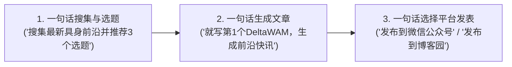

# intel-dispatch: 极简内容引擎端到端协作流

本 Skill 旨在让用户仅凭**三句自然语言**，即可驱动 `intel-nexus` 完成从全网学术/极客信源扫描、智能选题、专业技术成文，到全平台一键分发的全流程自治闭环。



---

## 阶段一：一句话信息搜集与选题推荐

当用户说：
- *“帮我搜集最新的具身智能/AI前沿情报，推荐几个值得写的选题”*
- *“最近有什么高热度的技术突破？给出选题建议”*

### Agent 执行动作
优先调用 FastMCP 工具 `suggest_topics` 或在项目目录下执行 CLI：
```bash
uv run intel-nexus topics --domain robotics --top 3
```

### 交付物规范
向用户展示 **3~5 个高信噪比选题卡片**，每个选题必须包含：
1. **标题与编号**（如 `[选题 1] DeltaWAM：双臂协作轻量化增量世界模型`）；
2. **权威评分**（综合分、学术突破分、社交热度/Upvotes/Comments）；
3. **推荐体裁**（「前沿快讯 Dispatch」用于突发单项突破；「深度专栏 Article」用于系统性范式剖析）；
4. **一句话看点与核心争议**（BLUF 核心结论、解决什么痛点、社区有什么槽点）；
5. **原始信源链接**（arXiv 论文、GitHub 代码仓或官网发布页）。

引导用户：“请回复想要撰写的选题编号（如‘写第 1 个’）或指定体裁。”

---

## 阶段二：一句话成文并落盘知识库

当用户说：
- *“就写第 1 个选题”*
- *“基于 DeltaWAM 写一篇前沿快讯”*
- *“写一篇关于 Dots 的阮一峰风格技术专栏”*

### Agent 执行动作
优先调用 FastMCP 工具 `generate_article` 或在项目目录下执行 CLI：
```bash
uv run intel-nexus write "<intel_id_or_title_keyword>" --genre dispatch --author K0maru3
```

### 写作铁律约束（强制对齐 AGENTS.md）
1. **隐私脱敏与去品牌化绝对禁止令**：
   - 严禁在正文、图说、图片提示词、图片水印中出现 `Intel Nexus` 字符串（私有引擎代号，对外一律去机构化，仅署个人作者 `K0maru3`）；
2. **严禁 Unicode ASCII 连线框图**：
   - 严禁在文章中使用 `┌─┐│└─┘` 等 ASCII 字符框图，必须使用结构化 Markdown 步骤、对比表格或信息卡片；
3. **真实性与严禁未来模型幻觉**：
   - 严禁自造内部概念或凭空捏造未发布模型（如 `GPT-6` 等）；所有术语与性能数据必须来自原论文或官方代码；
4. **中立严谨文风**：彻底剔除“彻底终结”、“颠覆格局”等宣传营销夸大辞藻；
5. **结构范式与收尾规范（一些看法）**：
   - 标题统一格式：`前沿快讯｜<Entity> 推出 <Tech>: <One-line essence>`；
   - 开篇直入主题：`先说结论`（BLUF，~50 字，禁止寒暄）；
   - 单个引用块（`>`）严禁超过 200 字，避免移动端排版严重拉长压迫；
   - 章节编号使用直观的平铺纯阿拉伯数字 `1 2 3`（严禁 `01 02 03`）；
   - **收尾杜绝模板化套话**：微信端与博客园末尾统一采用朴素的 `## 5 一些看法`，输出针对该技术的独立思考与定性研判（打破炒作泡沫、真实工程定位、生态护城河变迁），并反问读者或抛出具体落地设想（如“如果是你，会用这项技术来做什么/怎么做？”）；绝对严禁无脑复读“凌晨三点被 PagerDuty 叫醒的 On-Call 同事”等模版化烂梗；
6. **多媒体与封面图选型铁律（卡片级可读性）**：
   - 自动在 `99_Attachments/` 检索或抓取对应插图/动图并嵌入；
   - **封面图坚决抵制细碎流程图**：严禁将微观系统流程图、细碎框图、密集文字连线草图设为封面；封面图必须具备卡片级强辨识度（纯净大底、高视觉对比度、大号标签）、语义强呼应标题命门（如帕累托曲线、官方 Key Art、Dashboard 界面），居中构图防止裁剪。
7. **参考来源纯净铁律（严禁堆砌私有资产）**：
   - 文末「参考来源与权威信源」严格限定为可公开访问的官方文档、开源仓库与学术链接；
   - 严禁在文末追加面向本地文件系统的清单（如 `- 关联本地资产：`）；本地知识关联应存在于 YAML Frontmatter (`project:`, `up:`) 或正文内联概念双链中。
8. **落盘路径与门禁自检**：
   - 快讯：`/Users/k0maru3/Documents/SecondBrain/10_Projects/Intel-Nexus/Dispatches/`
   - 专栏：`/Users/k0maru3/Documents/SecondBrain/10_Projects/Intel-Nexus/Articles/`
   - **强制 Pre-flight 门禁自检**：成文落盘后，Agent 必须自动执行 `uv run intel-nexus lint <file_path>`，确保 0 Error 绿灯方可向用户交付！

向用户清晰展示成文标题、文件绝对路径，并附带开篇 200 字摘要预览。引导用户：“母稿已成功就绪并通过质量门禁，请选择想要发布的平台（微信公众号 / 博客园 / 知乎资产包）。”

---

## 阶段三：一句话多平台发表

当用户说：
- *“发布到微信公众号草稿箱”*
- *“推送到博客园”*
- *“发布到知乎专栏草稿”*
- *“存入 X 草稿箱” / “推送到 X (Twitter)”*

### Agent 执行动作
优先调用 FastMCP 工具 `publish_article` 或在项目目录下执行 CLI：
```bash
# 微信公众号（自动拉起 3~5 秒瞬态 SOCKS5 隧道 + Catppuccin Latte 内联排版 + 块级深度脱敏）
uv run intel-nexus publish "<article_file_path>" --platform wechat --tunnel tokyo-server

# 博客园（MetaWeblog XML-RPC 协议 + Obsidian/MD双语法素材自动上传 CDN 换链 + 作者去重 + mt_excerpt 带图摘要）
uv run intel-nexus publish "<article_file_path>" --platform cnblogs

# 知乎专栏草稿箱（Playwright 驱动落草稿，本地 Session 缓存）
uv run intel-nexus publish "<article_file_path>" --platform zhihu

# X (Twitter) 原生草稿箱（严格人机门禁，绝不直接发布；提取官方推文链接自动 Quote Tweet 卡片化）
uv run intel-nexus publish "<article_file_path>" --platform x
# 或指定 Quote Tweet 官方原帖链接
uv run intel-nexus push-x "<article_file_path>" --quote "https://x.com/figure_robot/status/..."
```

### 交付物反馈
明确告知用户：
- 发布状态与目标平台；
- 平台回执凭证（微信 Media ID / 博客园 Post ID & 预览链接 / 知乎草稿 URL / X 草稿箱状态 & 本地 staging 路径）；
- 封面图素材与摘要注入状态；
- 提醒用户打开手机端【公众号助手】或网页端草稿箱进行终审确认。

